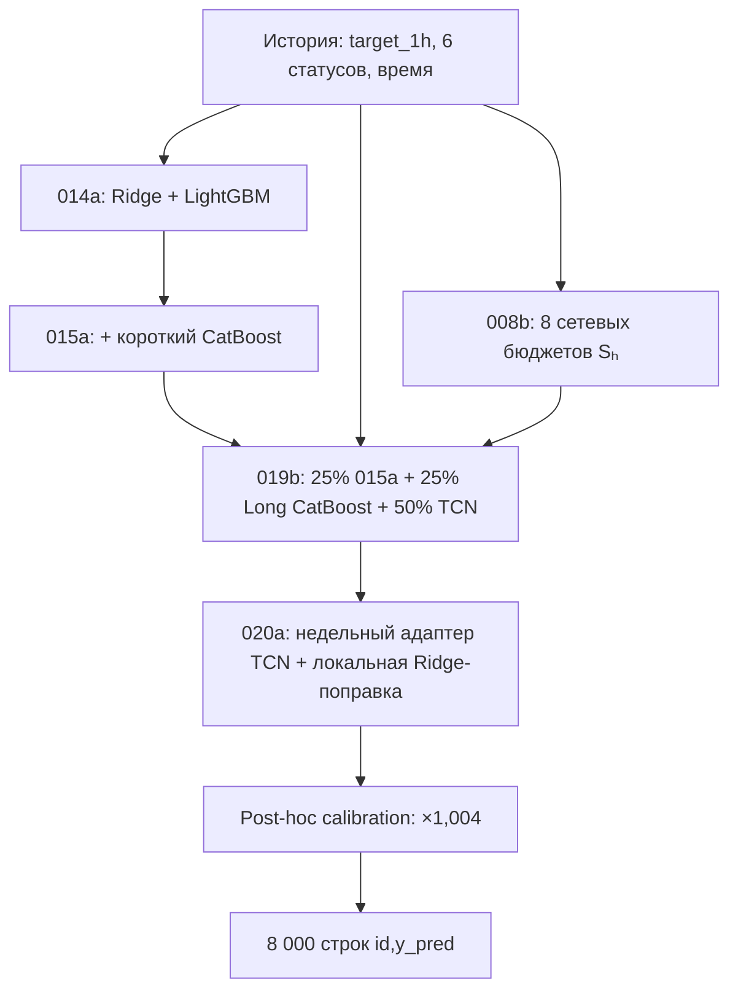

# RWB «Отгрузки без простоев» — модель 020a и финальная калибровка ×1,004

> **Статус решения:** лучший **из вариантов с предоставленным журналом Public Score** — `020a × 1,004`: **0,3210785427577813** (меньше — лучше). Это **Public Score = WAPE + |Relative Bias|**, а не отдельная WAPE и не независимая оценка Private Score. Данные о текущем месте в общем лидерборде здесь не приводятся: в материалах нет его проверяемого снимка.
>
> **Главные артефакты:** [код финального масштабирования](https://github.com/ILYA88G/RWB_hack/blob/develop/exp_029/public_scale.py) · [журнал результатов](https://github.com/ILYA88G/RWB_hack/blob/develop/exp_029/public_scale/scores.csv) · [лучший CSV](https://github.com/ILYA88G/RWB_hack/blob/develop/exp_029/public_scale/020a_scale_1.0040000.csv) · [паспорт проекта](RWB_project_passport_2026-11-10.docx) · [журнал использования ИИ](AI_usage_journal.md).
>
> Этот документ расположен в `docs/README.md`. Обычные относительные ссылки отсчитываются от каталога `docs/` и ведут в текущую ветку GitHub. **Артефакты `exp_029/public_scale` находятся в ветке `develop`**, поэтому ссылки на скрипт калибровки, журнал Public Score и финальный CSV явно указывают на `develop`; ссылки на остальные файлы остаются относительными. При последующем переносе `exp_029` в `main` эти ссылки можно перевести обратно на относительные.

## 1. Кратко о задаче и практическом применении

Неравномерные отгрузки усложняют заблаговременное планирование подачи транспорта. Если машин слишком мало, может возникнуть очередь или задержка; если слишком много — возрастает риск простоя и неэффективного использования ресурсов. **Результат проекта — прогноз нагрузки**, а не готовая система автоматического заказа автомобилей.

Для каждого из **1 000 маршрутов** строятся **8 прогнозов** на следующие 4 часа с шагом 30 минут. Пользователи возможного решения: транспортные планировщики, диспетчеры и складские логисты. Практический сценарий: прогноз поступает в диспетчерскую систему; после добавления вместимости автомобиля, времени подачи, остатка очереди и графика доступных машин может рассчитываться рекомендованное число автомобилей и время их подачи. **Ни транспортный план, ни сокращение простоев/затрат пока не подтверждены на реальных операционных данных.**

### Исходные данные

| Характеристика | Значение |
|---|---|
| Train | **4 630 000 строк**, 1 000 маршрутов × 4 630 получасовых временных точек |
| Период истории | **28.07.2025, 00:00 — 01.11.2025, 10:30** |
| Столбцы | `route_id`, `timestamp`, `status_1`–`status_6`, `target_1h` |
| Test | **8 000 строк**: 1 000 маршрутов × 8 горизонтов, время 11:00–14:30 01.11.2025 |
| Цель | `target_1h`: количество отгруженных товарных идентификаторов за предыдущий час |
| Статусы | Число товарных идентификаторов на шести **анонимных** этапах обработки; семантика этапов не раскрыта |

Один товар может присутствовать в нескольких статусах. Их простая сумма не интерпретируется как количество различных отгруженных товаров. По пояснению организаторов, данные частично синтетические; дополнительные внешние данные не использовались. Исходные Parquet **не отслеживались Git** в ранее предоставленном манифесте: они должны быть получены из официальной выдачи организаторов и размещены локально в `data/raw/`.

**Почему важны перекрывающиеся окна.** `target_1h` измеряет скользящий предыдущий час, а измерения идут каждые 30 минут. Значения соседних шагов перекрываются; сумма восьми целевых значений **не равна физическому количеству отгрузок за четыре часа**. Модели используют приблизительное причинное восстановление получасовой величины `q_t`, исходя из `y_t = q_{t-1} + q_t`. Это **оценка скрытой величины**, а не самостоятельный столбец исходных данных: функция [`halfhour_causal`](../train_model_014a.py) (также в [TCN-коде](../model_019b/predict_model_019b.py)).

## 2. Метрика и критерий успешности

На платформе используется:

```text
WAPE = Σ |ŷᵢ − yᵢ| / Σ yᵢ
Relative Bias = Σ ŷᵢ / Σ yᵢ − 1
Score = WAPE + |Relative Bias|      (меньше — лучше)
```

Истинные значения скрытого Test недоступны, поэтому **отдельные WAPE и Bias для Test не вычисляются командой**. Числа Public Score ниже получены из журнала отправок, переданного командой. Изменение Public Score не равно доказанному изменению физического объёма, времени доставки или затрат.

## 3. Принцип архитектуры: общий объём → доли маршрутов → масштаб



### 3.1. 008b: прогноз суммарной нагрузки сети

Сначала строится сетевой временной ряд: `target_1h` и статусы суммируются по всем маршрутам **для каждой временной отметки**. По календарю, лагам, скользящим средним и стандартным отклонениям оцениваются восемь общих будущих значений. В коде сопоставляются Ridge (14/28 дней) и LightGBM (28 дней). Калибровка исходного маршрутного прогноза ограничивается величиной **±5%**.

Для проверки гипотез использованы три временных фолда и leave-one-fold-out (LOFO). При валидации скрипт использует сохранённые OOF-прогнозы 005a и 006a; **при генерации финального `submission_network_008b.csv` масштабируются значения из `submission_lgbm_006a.csv`**. Это разные ветви одного скрипта; нельзя утверждать, что окончательный CSV представляет ту же смесь OOF без дополнительных условий.

Источники: [005a](../src/experiments/exp_005/train_lgbm_005a.py) · [006a](../src/experiments/exp_006/train_lgbm_006a.py) · [008b](../train_network_calibration_008b.py) · [поиск 008b](../reports/exp_008/network_008b_search.csv) · [LOFO 008b](../reports/exp_008/network_008b_lofo.csv) · [прогноз 008b](../submissions/submission_network_008b.csv).

### 3.2. 014a и 015a: распределение по маршрутам

- **014a:** Ridge по примерно 14 дням и LightGBM по примерно 21 дню (400 000 случайных примеров). Используются лаги `target_1h` и статусов, восстановленные получасовые объёмы, скользящие статистики и календарь. Внутреннее объединение долей: **50% Ridge / 50% LightGBM**.
- **015a:** к 014a добавлен CatBoost — 400 000 примеров за последние 21 день, MAE, 1 000 деревьев глубины 6. Дополнительные признаки: изменчивость и частота низких значений на окнах 8, 48, 336 получасовых точек. Ансамбль долей: **50% результата 014a / 50% CatBoost**; после раскрытия весов — 25% Ridge, 25% LightGBM, 50% короткий CatBoost.

Для каждого горизонта прогноз компонента `P_{r,h}` нормируется к общему бюджету `S_h`:

```text
N_S(P)_{r,h} = P_{r,h} × S_h / Σᵣ P_{r,h}
```

Это сохраняет относительные пропорции между маршрутами, но согласует сумму по ним с общим сетевым прогнозом. Ссылки: [код 014a](../train_model_014a.py) · [код 015a](../train_model_015a.py) · [CSV 014a](../submissions/submission_model_014a.csv) · [CSV 015a](../submissions/submission_model_015a.csv).

### 3.3. 019b: длинный CatBoost и TCN

**Long CatBoost:** 800 000 примеров, составленных из двух выборок по 400 000 (недавняя история и интервал до 84 суток). 1 400 деревьев глубины 6, MAE, веса с повышенным вниманием к недавним наблюдениям. Сохранённая модель обучалась на данных с отсечкой **30.10.2025, 10:30**.

**Temporal Convolutional Network (TCN):** последовательный вход — 48 получасовых точек (24 часа) по восьми каналам: `target_1h`, оценённый получасовой объём и шесть статусов. Используются статические признаки, недельные профили, календарь будущих горизонтов и embedding маршрута размерности 8. Применяются причинные свёртки с расширениями 1, 2, 4, 8 и 16; сохранённый компонент обучался 34 эпохи. Сетевые бюджеты распределяются сначала между будущими получасовыми величинами, затем восстанавливаются согласованные часовые прогнозы.

Ансамбль нормированных компонент:

```text
P019b = 0,25 × P015a + 0,25 × N_S(Long CatBoost) + 0,50 × TCN
```

Код: [обучение компонентов](../model_019b/train_components_019b.py) · [архитектура и предсказание](../model_019b/predict_model_019b.py) · [веса CatBoost](../model_019b/refitted/long_cat_1030_1030.cbm) · [веса TCN](../model_019b/refitted/model019a.pt) · [журнал TCN](../model_019b/refitted/tcn_training.json) · [CSV 019b](../submissions/submission_model_019b.csv).

### 3.4. 020a: недельный адаптер и локальная Ridge-коррекция

Базовая TCN замораживается. Адаптер получает **336 получасовых точек (7 суток)** по восьми каналам, усреднённые до 84 двухчасовых сегментов (672 входных числа), и обучается восемь эпох. Отдельная устойчивая Ridge-коррекция использует примерно 14 дней истории; для каждого маршрута выполняются шесть итераций перевзвешивания остатков, применяется регуляризация `alpha=400`.

```text
P020a = P019b
      + 0,5 × (TCN_с_адаптером − TCN_без_адаптера)
      + 0,0625 × (локальная_Ridge − общая_Ridge)
```

**Разности предварительно согласованы по сетевым бюджетам, поэтому их сумма по маршрутам на каждом горизонте равна нулю.** До завершающей калибровки 020a сохраняет общие суммы 008b. В развёрнутом ансамбле долей: 6,25% Ridge + 6,25% LightGBM + 12,5% короткий CatBoost + 25% Long CatBoost + 50% адаптированная TCN; локальная Ridge — дополнительная поправка, а не шестой независимый вес.

[Код 020a](../model_019b/upgrade_model_020a.py) · [веса адаптера](../model_019b/refitted/model020a_adapter.pt) · [исходный CSV 020a](../submissions/submission_model_020a.csv).

## 4. Где именно используется сезонность

Сезонность **не просто упомянута в презентации — она закодирована в признаках**:

| Уровень | Реализация | Где смотреть |
|---|---|---|
| Сеть, 008b | Получасовой слот суток, день недели, `sin/cos` времени, признак выходного; лаги вплоть до 336 получасовых слотов | [build_network()](../train_network_calibration_008b.py) |
| Ridge и бустинги, 014a–015a | Циклические `sin/cos` для времени суток и дня недели; лаги 48 (сутки), 336 (неделя), скользящие статистики | [train_model_014a.py](../train_model_014a.py), [train_model_015a.py](../train_model_015a.py) |
| Long CatBoost и TCN, 019b | Недельные исторические аналоги и профили, календарь будущих восьми шагов | [predict_model_019b.py](../model_019b/predict_model_019b.py) |
| Адаптер 020a | Семидневная последовательность из 336 слотов, агрегированная в 84 сегмента | [long_features()](../model_019b/upgrade_model_020a.py) |

**Ограничение:** наличие сезонных признаков показывает, что модель *может* учитывать суточные и недельные повторения. Оно **не доказывает** реальное влияние каждого признака или сезонный экономический эффект: для этого нужны отдельные эксперименты с исключением признаков (ablation).

## 5. Финальная post-hoc calibration и эксперимент с множителями

Это **второй, отдельный уровень калибровки**, не тождественный 008b. После формирования окончательного `submission_model_020a.csv` все 8 000 прогнозов умножаются на общий коэффициент `k`:

```text
ŷ_final(r,h) = k × ŷ_020a(r,h),       k = 1,004
```

Отсюда немедленно следует: **общие прогнозируемые объёмы по каждому горизонту увеличиваются на 0,4%**, а доля каждого маршрута внутри горизонта остаётся неизменной. Для фиксированных истинных значений `y` зависимость конкурсной метрики от `k` имеет вид:

```text
Score(k) = [Σᵢ |k·ŷᵢ − yᵢ| + |k·Σᵢ ŷᵢ − Σᵢ yᵢ|] / Σᵢ yᵢ
```

Таким образом, небольшая поправка масштаба может изменить **оба** слагаемых Score: WAPE и абсолютное смещение. **Нельзя утверждать**, что именно Bias снизился на определённую величину: платформа показывает только суммарную метрику.

### Зафиксированные отправки (из переданного командой `scores.csv`)

| Модель | Коэффициент `k` | Public Score ↓ | Вывод |
|---|---:|---:|---|
| 020a | 0,990 | 0,33383180014996616 | хуже исходного |
| 020a | 1,000 | 0,3246728080471545 | исходный прогноз |
| **020a** | **1,004** | **0,3210785427577813** | **лучший среди оценённых вариантов 020a** |
| 020a | 1,010 | 0,3275406578927778 | хуже исходного |
| 028fresh | 1,004 | 0,3218038660963992 | хуже `020a × 1,004` |

**Фактическое улучшение для сравнимых вариантов 020a:**

- абсолютное снижение Score: **0,0035942652893732**;
- относительное снижение Score: **≈ 1,1070%** относительно исходного `020a × 1,000`;
- сумма восьми перекрывающихся часовых прогнозов изменилась с **2 219 915 137,27** до **2 228 794 797,82** (+8 879 660,55 в сумме целевых показателей). Это **не число дополнительных физических отгрузок**.

**Как получены файлы:** скрипт [`exp_029/public_scale.py`](https://github.com/ILYA88G/RWB_hack/blob/develop/exp_029/public_scale.py) читает базовый `submission_model_020a.csv`, проверяет схему, число и уникальность `id`, конечность и неотрицательность `y_pred`, умножает значения на коэффициент, сохраняет CSV и перепроверяет после повторного чтения. Он вычисляет SHA-256 созданного файла. Опция `--score` **записывает в журнал сообщённый извне Public Score**, но не рассчитывает конкурсную метрику и не подключается к платформе.

[Код калибровки](https://github.com/ILYA88G/RWB_hack/blob/develop/exp_029/public_scale.py) · [журнал Public Score](https://github.com/ILYA88G/RWB_hack/blob/develop/exp_029/public_scale/scores.csv) · [лучший файл 020a × 1,004](https://github.com/ILYA88G/RWB_hack/blob/develop/exp_029/public_scale/020a_scale_1.0040000.csv).

## 6. Проверка и воспроизводимость

**Уже реализованные проверки:** целостность и регулярность временной сетки, отсутствие пропусков/повторов/отрицательных значений, проверка маршрутов и 8 горизонтов, 8 000 уникальных `id`, согласование сетевых сумм до последнего множителя, сопоставление входного и масштабированного CSV после повторного чтения.

**Результаты ранней валидации:** [журнал экспериментов](../reports/experiment_log.md), [OOF 006a](../reports/exp_006/oof_fold_3.npz), [таблица 008b](../reports/exp_008/network_008b_search.csv), [LOFO 008b](../reports/exp_008/network_008b_lofo.csv). Проверка ранних моделей по временным фолдам **не равна независимой валидации всей системы 020a**. Во время обучения TCN/адаптера для распределения используются фактические будущие суммы исторических меток; соответствующие train-метрики нельзя выдавать за прогнозную ошибку на скрытом Test.

### Минимальное воспроизведение готового лучшего файла

Запускать из корня репозитория. Нужны: Python и зависимости из [`requirements.txt`](../requirements.txt) / [`model_019b/requirements.txt`](../model_019b/requirements.txt); исходный конкурсный Train и Test для пересборки 020a; веса TCN и адаптера, совместимые между собой; готовый CSV 019b.

**Вариант A — только воспроизвести post-hoc calibration из сохранённого `020a`:**

```bash
python exp_029/public_scale.py 1.004
```

Вход: `submissions/submission_model_020a.csv`; выход: `exp_029/public_scale/020a_scale_1.0040000.csv`. **Обучение здесь не выполняется.** Для сопоставления с отправкой можно сравнить SHA-256.

**Вариант B — пересобрать 020a из зафиксированных компонентов и затем откалибровать:**

```bash
python model_019b/upgrade_model_020a.py \
  --train data/raw/train_solo_track.parquet \
  --test data/raw/test_solo_track.parquet \
  --base submissions/submission_model_019b.csv \
  --tcn model_019b/refitted/model019a.pt \
  --checkpoint model_019b/refitted/model020a_adapter.pt \
  --output submissions/submission_model_020a.csv \
  --predict-only

python exp_029/public_scale.py 1.004
```

Для сборки **самого 019b** дополнительно нужны [Long CatBoost](../model_019b/refitted/long_cat_1030_1030.cbm), [код 019b](../model_019b/predict_model_019b.py) и `submission_model_015a.csv`. Полный воспроизводимый эксперимент по всем историческим фолдам потребует повторного обучения компонентов до каждой временной отсечки. Различия библиотек и окружения могут влиять на побайтовое совпадение результатов.

## 7. Дорожная карта внедрения и проверяемые критерии

| Этап | Что делаем | Что считаем результатом |
|---|---|---|
| **1. Независимая проверка** | Rolling-origin / walk-forward: переобучаем компоненты только на прошлом, проверяем отдельные маршруты и горизонты; коэффициент выбираем без использования контрольного периода | Устойчивое улучшение Score и отсутствие утечки |
| **2. Операционные данные** | Получаем время подачи, вместимость машин/тары, остатки очереди, доступность транспорта, ограничения погрузочных зон | Возможность превратить прогноз в потребность в машинах |
| **3. Планировщик** | Преобразуем **неперекрывающиеся** прогнозы получасовых объёмов в предложения по подаче автомобилей; учитываем запас на неопределённость | Выполнимый план с ограничениями по ресурсам |
| **4. Контролируемый пилот** | Сравниваем работу с подсказками и без них в сопоставимых условиях, фиксируем решения диспетчера | Проверенные KPI: ожидание, задержки, загрузка транспорта и операционные затраты |
| **5. Эксплуатация** | Мониторинг WAPE/Bias по сегментам, drift, обновление моделей и калибровки | Повторяемый процесс без деградации качества |

Потенциальный эффект — снижение риска задержек и неэффективной подачи машин. **Экономия и влияние на частоту заказов покупателей пока не измерены.** Чтобы заявить экономические цифры, нужны исходные операционные показатели и экспериментальная оценка.

## 8. Команда, дисциплины и ИИ

| Участник | Закреплённая роль / направление |
|---|---|
| **Сычева Виктория Сергеевна** | Data Analyst / Team Lead — анализ данных и координация |
| **Пронина Виктория Сергеевна** | ML Researcher — гипотезы, сравнение моделей и проверка качества |
| **Голиков Илья Русланович** | ML Engineer — модельные скрипты, интеграция прогнозов, воспроизводимость |
| **Ахметшин Руслан Маратович** | Feature Engineer — признаки, лаги, сезонность и контроль информационной доступности |
| **Бондарева Мария Алексеевна** | Product / Business Analyst & Integrator — практическое применение, бизнес-требования и интеграция результатов |

**Примечание:** здесь приведено закреплённое распределение ролей, **не верифицированное авторство каждой отдельной модели или коммита**; персональные фактические вклады команда должна подтвердить перед защитой. Предметная связь: программирование, статистика, машинное обучение, временные ряды, логистика; это названия областей, а не проверенный список образовательных дисциплин команды.

При разработке использовались ChatGPT и OpenAI Codex для анализа постановки и ограничений, исследования архитектур, проверки кода и подготовки документации. Их предложения не заменяли проверку по данным, коду и доступным метрикам. [Журнал применения ИИ](AI_usage_journal.md).

## 9. Артефакты и вопросы экспертам

**Основные артефакты:** [финальная постобработка](https://github.com/ILYA88G/RWB_hack/blob/develop/exp_029/public_scale.py), [журнал коэффициентов](https://github.com/ILYA88G/RWB_hack/blob/develop/exp_029/public_scale/scores.csv), [финальный CSV](https://github.com/ILYA88G/RWB_hack/blob/develop/exp_029/public_scale/020a_scale_1.0040000.csv), [базовый CSV 020a](../submissions/submission_model_020a.csv), [код 020a](../model_019b/upgrade_model_020a.py), [веса TCN](../model_019b/refitted/model019a.pt), [веса адаптера](../model_019b/refitted/model020a_adapter.pt), [код 008b](../train_network_calibration_008b.py), [отчёты проверки](../reports/exp_008/network_008b_search.csv), [паспорт](RWB_project_passport_2026-11-10.docx), [журнал ИИ](AI_usage_journal.md).

**Репозиторий:** https://github.com/ILYA88G/RWB_hack
